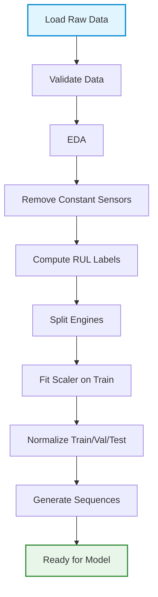

# Dataset & Data Pipeline Specification

## 1. Dataset Source

### 1.1 Primary Dataset: NASA C-MAPSS

**Full Name**: Commercial Modular Aero-Propulsion System Simulation (C-MAPSS) Jet Engine Simulated Data

**Publisher**: NASA Prognostics Center of Excellence (PCoE), NASA Ames Research Center

**Source URL**: https://data.nasa.gov/dataset/cmapss-jet-engine-simulated-data

**Alternative Source**: https://phm-datasets.s3.amazonaws.com/NASA/17.+Turbofan+Engine+Degradation+Simulation+Data+Set+2.zip

**Hugging Face Version**: https://huggingface.co/datasets/SoyVitou/NASA-C-MAPSS-Turbofan-Engine

**Citation**: 
- M. Chao, C. Kulkarni, K. Goebel and O. Fink (2021). "Aircraft Engine Run-to-Failure Dataset under real flight conditions", NASA Prognostics Data Repository, NASA Ames Research Center, Moffett Field, CA

---

## 2. Dataset License/Usage Restrictions

### 2.1 License Status

**License**: Public Domain / NASA Open Data

**Usage Restrictions**: None

**Requirements**:
- Citation required for academic use
- Acknowledgment of NASA PCoE recommended

**Commercial Use**: Allowed (public domain)

**Modification**: Allowed

**Redistribution**: Allowed

---

## 3. Dataset Variants/Configurations

### 3.1 Available Subsets

The NASA C-MAPSS dataset contains four subsets with varying complexity:

| Subset | Train Engines | Test Engines | Operating Conditions | Fault Modes | Fault Type |
|--------|---------------|---------------|----------------------|-------------|------------|
| FD001 | 100 | 100 | 1 (Sea Level) | 1 | HPC Degradation |
| FD002 | 260 | 259 | 6 | 1 | HPC Degradation |
| FD003 | 100 | 100 | 1 | 2 | HPC Degradation, Fan Degradation |
| FD004 | 248 | 249 | 6 | 2 | HPC Degradation, Fan Degradation |

### 3.2 Selected Subset for Baseline

**Primary Choice**: FD001

**Rationale**:
- Simplest configuration (1 operating condition, 1 fault mode)
- Fewest engines (100 train, 100 test) - faster training
- Established baseline in literature
- Suitable for academic mini-project scope

### 3.3 Complete Dataset Coverage

**All Subsets**: The pipeline should support all four subsets (FD001, FD002, FD003, FD004)

**Implementation Strategy**:
- Baseline development on FD001
- Extension to FD002, FD003, FD004 for comprehensive evaluation
- Each subset requires separate model training due to different characteristics
- Results should be reported for all subsets to demonstrate generalization

### 3.4 Subset Characteristics Comparison

| Subset | Complexity | Train Engines | Test Engines | Conditions | Fault Modes | Use Case |
|--------|------------|---------------|---------------|------------|-------------|----------|
| FD001 | Low | 100 | 100 | 1 | 1 | Baseline, quick experiments |
| FD002 | Medium | 260 | 259 | 6 | 1 | Multi-condition evaluation |
| FD003 | Medium | 100 | 100 | 1 | 2 | Multi-fault evaluation |
| FD004 | High | 248 | 249 | 6 | 2 | Comprehensive evaluation |

---

## 4. Dataset Structure

### 4.1 File Format

**Format**: Space-separated text files

**Columns**: 26 columns per row

**File Types**:
- `train_FD001.txt`: Training trajectories (run-to-failure)
- `test_FD001.txt`: Test trajectories (partial, ends before failure)
- `RUL_FD001.txt`: True RUL values for final cycle of each test engine

### 4.2 Column Structure

| Column Index | Column Name | Description |
|-------------|-------------|-------------|
| 1 | unit | Engine unit identifier |
| 2 | cycle | Time in operational cycles |
| 3 | setting_1 | Operational setting 1 |
| 4 | setting_2 | Operational setting 2 |
| 5 | setting_3 | Operational setting 3 |
| 6-26 | sensor_1 to sensor_21 | Sensor measurements |

**Total Columns**: 26 (1 unit + 1 cycle + 3 settings + 21 sensors)

---

## 5. Engine/Unit Identifier

### 5.1 Unit Column

**Column**: `unit` (column 1)

**Values**: Integer identifiers (1 to N)

**Purpose**: 
- Identifies individual engines in the fleet
- Enables engine-level operations (grouping, splitting)
- Critical for preventing data leakage

**Characteristics**:
- Each unit represents a unique engine
- Units are independent (no relationship between unit 1 and unit 2)
- Initial wear and manufacturing variation unknown but normal

---

## 6. Time/Cycle Information

### 6.1 Cycle Column

**Column**: `cycle` (column 2)

**Values**: Integer starting from 1

**Purpose**: 
- Temporal ordering within each engine
- Represents operational time steps
- Used for RUL computation

**Characteristics**:
- Cycles are sequential (1, 2, 3, ...)
- Different engines have different total cycles
- Training data: cycles continue until failure
- Test data: cycles end before failure

**Example**:
```
Engine 1: cycles 1 to 200 (fails at cycle 200)
Engine 2: cycles 1 to 150 (fails at cycle 150)
```

---

## 7. Sensor Variables

### 7.1 Sensor Measurements

**Columns**: `sensor_1` to `sensor_21` (columns 6-26)

**Count**: 21 sensor channels

**Nature**: 
- Simulated sensor readings with noise
- Different sensors measure different physical parameters
- Some sensors may be constant or near-constant
- Sensor values affected by operational settings and degradation

**Physical Interpretations** (from Hugging Face dataset):
- Various pressure, temperature, speed, and flow measurements
- Specific sensor names available in cleaned Hugging Face version
- Raw NASA dataset uses generic sensor_1 to sensor_21 naming

**Characteristics**:
- Values are continuous (floating-point)
- Different scales across sensors
- Some sensors show degradation trends
- Some sensors are uninformative (constant)

---

## 8. Operational Settings

### 8.1 Setting Columns

**Columns**: `setting_1`, `setting_2`, `setting_3` (columns 3-5)

**Purpose**: 
- Represent operational conditions
- Affect sensor readings
- Vary across subsets (FD001 has 1 condition, FD002/FD004 have 6)

**Characteristics**:
- FD001: Single operating condition (sea level)
- FD002/FD004: Six different operating conditions
- Settings are categorical or continuous depending on subset
- Should be used as features or handled separately

**Usage in Pipeline**:
- Option 1: Include as features (3 additional columns)
- Option 2: Use for stratification in splitting
- Option 3: Analyze separately (not used for baseline)

**Recommendation**: Include as features for baseline, can experiment with excluding later

---

## 9. Target Definition

### 9.1 Remaining Useful Life (RUL)

**Definition**: Number of remaining operational cycles before engine failure

**Nature**: Regression target (continuous, non-negative)

**Units**: Cycles

**Range**: 
- Training: 0 to (max_cycle - 1)
- Test: 0 to (final_RUL + max_test_cycle - 1)

**Characteristics**:
- Decreases as engine approaches failure
- RUL = 0 at failure (training data)
- RUL > 0 at last observed cycle (test data)

---

## 10. RUL Formulation

### 10.1 Training Data RUL

**Formula**:
```
RUL = max_cycle_for_engine - current_cycle
```

**Example**:
```
Engine 1 with max_cycle = 200:
- At cycle 1: RUL = 200 - 1 = 199
- At cycle 50: RUL = 200 - 50 = 150
- At cycle 199: RUL = 200 - 199 = 1
- At cycle 200: RUL = 200 - 200 = 0 (failure)
```

**Implementation**:
```python
def compute_training_rul(df):
    max_cycles = df.groupby('unit')['cycle'].max()
    df['RUL'] = df.apply(lambda row: max_cycles[row['unit']] - row['cycle'], axis=1)
    return df
```

### 10.2 Test Data RUL

**Formula**:
```
row_RUL = max_test_cycle_for_engine - current_cycle + final_RUL
```

Where:
- `max_test_cycle_for_engine`: Last cycle observed in test file
- `final_RUL`: True RUL at last cycle (from RUL_FD001.txt)

**Example**:
```
Engine 1 in test:
- Observed cycles: 1 to 100
- final_RUL from RUL file: 50
- At cycle 1: RUL = 100 - 1 + 50 = 149
- At cycle 50: RUL = 100 - 50 + 50 = 100
- At cycle 100: RUL = 100 - 100 + 50 = 50 (true RUL at last observation)
```

**Implementation**:
```python
def compute_test_rul(df, rul_file):
    final_ruls = load_rul_file(rul_file)  # {unit: final_RUL}
    max_cycles = df.groupby('unit')['cycle'].max()
    df['RUL'] = df.apply(
        lambda row: max_cycles[row['unit']] - row['cycle'] + final_ruls[row['unit']], 
        axis=1
    )
    return df
```

---

## 11. Training Data

### 11.1 Training File Structure

**File**: `train_FD001.txt`

**Engines**: 100 engines

**Trajectories**: Complete run-to-failure

**Total Rows**: ~20,000+ (varies by engine)

**Characteristics**:
- Each engine runs until failure
- Last cycle for each engine has RUL = 0
- Used for model training

**Data Splitting**:
- Further split into train/validation at engine level
- Example: 80 engines train, 10 engines validation, 10 engines test (from original test set)

---

## 12. Validation Strategy

### 12.1 Engine-Level Split

**Critical Requirement**: Split at engine level, not row level

**Why Engine-Level Split?**
- Prevents data leakage
- Engines are independent units
- Row-level split would mix past and future cycles from same engine
- Real-world scenario: predict RUL for unseen engines

**Split Method**:
```python
# Get unique engine IDs
unique_units = train_df['unit'].unique()

# Shuffle units
np.random.seed(42)
np.random.shuffle(unique_units)

# Split
n_train = int(0.8 * len(unique_units))
n_val = int(0.1 * len(unique_units))

train_units = unique_units[:n_train]
val_units = unique_units[n_train:n_train + n_val]
test_units = unique_units[n_train + n_val:]  # Or use original test set

# Filter dataframes
train_df = train_df[train_df['unit'].isin(train_units)]
val_df = train_df[train_df['unit'].isin(val_units)]
```

**Test Set**: Use original test file (FD001 test) as final test set

---

## 13. Test Data

### 13.1 Test File Structure

**File**: `test_FD001.txt`

**Engines**: 100 engines

**Trajectories**: Partial (ends before failure)

**Total Rows**: ~13,000+

**Characteristics**:
- Each engine stops before failure
- Last cycle RUL is provided separately
- Used for final evaluation only

### 13.2 RUL File

**File**: `RUL_FD001.txt`

**Format**: Single column, one value per engine

**Content**: True RUL at last observed cycle for each test engine

**Purpose**: 
- Provides ground truth for test evaluation
- Used to compute row-level RUL for test data

**Example**:
```
112
98
65
...
```
(100 values, one per test engine)

---

## 14. Missing Values

### 14.1 Missing Value Status

**Finding**: NASA C-MAPSS dataset has no missing values

**Verification Required**: 
- Check for NaN values during data validation
- Confirm all 26 columns have values for all rows

**Handling Strategy**:
- If missing values found: investigate cause
- Likely not an issue for this dataset
- Document if any missing values detected

---

## 15. Constant/Near-Constant Sensors

### 15.1 Identification

**Issue**: Some sensors may be constant or near-constant across all engines

**Detection Method**:
```python
# Compute variance per sensor
sensor_vars = df[sensor_columns].var()

# Identify constant sensors (variance < threshold)
constant_sensors = sensor_vars[sensor_vars < 1e-6].index.tolist()
```

**Expected Behavior**:
- Some sensors in C-MAPSS are known to be constant
- Constant sensors provide no information for learning
- Should be identified and removed

### 15.2 Handling Strategy

**Option 1: Remove Constant Sensors**
- Drop sensors with variance below threshold
- Reduces feature dimensionality
- Improves training efficiency

**Option 2: Keep All Sensors**
- Let model learn to ignore uninformative features
- Simpler pipeline
- May add noise

**Recommendation**: Remove constant sensors after EDA

**Implementation**:
```python
def remove_constant_sensors(df, threshold=1e-6):
    sensor_cols = [col for col in df.columns if col.startswith('sensor_')]
    sensor_vars = df[sensor_cols].var()
    constant_sensors = sensor_vars[sensor_vars < threshold].index.tolist()
    
    if constant_sensors:
        logger.info(f"Removing constant sensors: {constant_sensors}")
        df = df.drop(columns=constant_sensors)
    
    return df, constant_sensors
```

---

## 16. Outliers

### 16.1 Outlier Detection

**Methods**:
- Z-score analysis per sensor
- IQR (Interquartile Range) method
- Visual inspection via boxplots

**Expected Behavior**:
- Simulated data with noise may have outliers
- Outliers may be realistic (sensor noise) or errors
- Need to distinguish between noise and errors

### 16.2 Handling Strategy

**Recommendation**: Do not remove outliers for baseline

**Rationale**:
- Outliers may represent realistic sensor noise
- LSTM models can handle some noise
- Removing outliers may remove valid signal
- Can experiment with outlier removal as extension

**Implementation**: Skip outlier removal for baseline, document as future work

---

## 17. Sensor Normalization

### 17.1 Normalization Requirement

**Why Normalize?**
- Sensors have different scales and ranges
- LSTM models sensitive to input scale
- Gradient stability during training
- Faster convergence

### 17.2 Normalization Methods

**Option 1: MinMaxScaler (Recommended)**
- Scales features to [0, 1] range
- Formula: `X_scaled = (X - X_min) / (X_max - X_min)`
- Good for LSTM (bounded range)
- Preserves zero values

**Option 2: StandardScaler**
- Scales to zero mean, unit variance
- Formula: `X_scaled = (X - X_mean) / X_std`
- Good for normally distributed data
- Handles outliers better

**Recommendation**: MinMaxScaler for baseline

### 17.3 Normalization Implementation

**Critical**: Fit scaler on training data only

```python
from sklearn.preprocessing import MinMaxScaler

# Fit on training data
scaler = MinMaxScaler()
train_features = scaler.fit_transform(train_df[feature_columns])

# Apply to validation and test
val_features = scaler.transform(val_df[feature_columns])
test_features = scaler.transform(test_df[feature_columns])

# Save scaler for inference
joblib.dump(scaler, 'models/scaler.pkl')
```

**Why Fit on Training Only?**
- Prevents data leakage
- Validation/test should not influence scaling parameters
- Mimics real-world inference scenario

---

## 18. Feature Selection

### 18.1 Baseline Feature Set

**Primary Approach**: Use all non-constant sensors + operational settings

**Features**:
- `setting_1`, `setting_2`, `setting_3` (3 features)
- `sensor_1` to `sensor_21` (21 features, minus constant sensors)
- Total: ~24 features (depending on constant sensors)

**Rationale**:
- Simple baseline
- Let model learn feature importance
- Can refine based on EDA

### 18.2 Advanced Feature Selection (Optional)

**Methods**:
- Correlation analysis (remove highly correlated sensors)
- Feature importance from baseline model
- Recursive feature elimination
- Domain knowledge (physics-based selection)

**Implementation**: Future work, not required for baseline

---

## 19. Sequence Generation

### 19.1 Sliding Window Approach

**Purpose**: Convert time-series data into sequences for LSTM

**Method**: For each engine, generate sliding windows of length `window_size`

**Parameters**:
- `window_size`: Number of cycles in each sequence (e.g., 30)
- `step`: Step size between windows (default: 1 for overlapping windows)

**Example** (window_size = 30, engine with 100 cycles):
```
Sequence 1: cycles 1-30 → RUL at cycle 30
Sequence 2: cycles 2-31 → RUL at cycle 31
Sequence 3: cycles 3-32 → RUL at cycle 32
...
Sequence 71: cycles 71-100 → RUL at cycle 100
```

**Total Sequences**: `n_cycles - window_size + 1`

### 19.2 Sequence Generation Implementation

```python
def generate_sequences(df, window_size, feature_columns, target_column='RUL'):
    sequences = []
    targets = []
    
    for unit in df['unit'].unique():
        unit_data = df[df['unit'] == unit].sort_values('cycle')
        unit_features = unit_data[feature_columns].values
        unit_targets = unit_data[target_column].values
        
        for i in range(len(unit_data) - window_size + 1):
            sequences.append(unit_features[i:i + window_size])
            targets.append(unit_targets[i + window_size - 1])
    
    return np.array(sequences), np.array(targets)
```

**Output Shapes**:
- `X`: `(n_sequences, window_size, n_features)`
- `y`: `(n_sequences,)`

### 19.3 Window Size Selection

**Default**: 30 cycles

**Rationale**:
- Sufficient temporal context
- Not too long (computationally expensive)
- Common choice in literature

**Alternatives**: 20, 50, 100 (can experiment)

**Trade-offs**:
- Larger window: More context, slower training
- Smaller window: Faster, less context

---

## 20. Window Size

### 20.1 Recommended Window Size

**Baseline**: 30 cycles

**Considerations**:
- Degradation patterns may manifest over different timescales
- Too small: insufficient temporal context
- Too large: may include irrelevant history, slower training

### 20.2 Window Size Experiments (Future)

**Test Values**: 10, 20, 30, 50, 100

**Evaluation**: Compare MAE/RMSE across window sizes

**Implementation**: Hyperparameter tuning

---

## 21. Prediction Horizon

### 21.1 Definition

**Prediction Horizon**: How far ahead RUL is predicted

**Current Approach**: Predict RUL at last cycle of window (1-step ahead from window end)

**Alternative**: Multi-step prediction (predict RUL at multiple future cycles)

**Recommendation**: Single-step prediction for baseline (RUL at window end)

---

## 22. Label Generation

### 22.1 Label Assignment

**Training Data**:
- For each sequence, label = RUL at last cycle in window
- Example: Sequence cycles 1-30 → label = RUL at cycle 30

**Test Data**:
- Same approach
- Use computed RUL from Section 10.2

### 22.2 Label Clipping (Optional)

**Issue**: Very high RUL values early in engine life may be less informative

**Option**: Clip RUL to maximum value (e.g., 125 cycles)

**Rationale**:
- Early degradation patterns may be similar regardless of exact RUL
- Common practice in literature
- Reduces label range

**Implementation**:
```python
df['RUL'] = df['RUL'].clip(upper=125)
```

**Recommendation**: Experiment with clipping, not required for baseline

---

## 23. Data Splitting

### 23.1 Split Strategy

**Training Set**: 80% of training engines (from train_FD001.txt)

**Validation Set**: 20% of training engines (from train_FD001.txt; held out before preprocessing)

**Test Set**: Original test file (test_FD001.txt)

**Rationale**:
- Validation for hyperparameter tuning and early stopping
- Test set completely held out for final evaluation
- Mimics real-world scenario (unseen engines)

### 23.2 Split Implementation

```python
def split_engines(train_df, train_ratio=0.8, val_ratio=0.1, random_seed=42):
    np.random.seed(random_seed)
    
    unique_units = train_df['unit'].unique()
    np.random.shuffle(unique_units)
    
    n_train = int(train_ratio * len(unique_units))
    n_val = int(val_ratio * len(unique_units))
    
    train_units = unique_units[:n_train]
    val_units = unique_units[n_train:n_train + n_val]
    
    train_split = train_df[train_df['unit'].isin(train_units)]
    val_split = train_df[train_df['unit'].isin(val_units)]
    
    return train_split, val_split
```

### 23.3 Why Not Random Row-Level Split?

**Problem with Row-Level Split**:
- Would mix cycles from same engine across train/val/test
- Data leakage: future cycles in training, past cycles in test
- Unrealistic: real deployment predicts for unseen engines

**Example** (Bad):
```
Engine 1 cycles 1-100:
- Train: cycles 1-70
- Test: cycles 71-100
→ Model has seen early degradation of engine 1, tested on late degradation
```

**Correct Approach** (Engine-Level):
```
Engine 1 cycles 1-100:
- Train: All cycles (engine 1 in training set)
Engine 2 cycles 1-80:
- Test: All cycles (engine 2 in test set)
→ Model has never seen engine 2 during training
```

---

## 24. Leakage Prevention

### 24.1 Leakage Sources

**Source 1: Row-Level Splitting**
- **Risk**: Future cycles in training, past cycles in test
- **Prevention**: Engine-level splitting

**Source 2: Normalization**
- **Risk**: Fitting scaler on all data
- **Prevention**: Fit scaler on training data only

**Source 3: Sequence Generation**
- **Risk**: Cross-engine sequences
- **Prevention**: Generate sequences per-engine only

**Source 4: Feature Engineering**
- **Risk**: Using global statistics
- **Prevention**: Compute statistics per-engine or on training set

### 24.2 Leakage Prevention Checklist

- [ ] Engine-level train/val/test split
- [ ] Scaler fitted on training data only
- [ ] Sequences generated per-engine
- [ ] No cross-engine information leakage
- [ ] Validation engines not used in training
- [ ] Test engines not used in training or validation

---

## 25. Data Validation

### 25.1 Validation Checks

**Schema Validation**:
- Correct number of columns (26)
- Correct column names
- Correct data types (numeric)

**Integrity Validation**:
- No missing values
- No duplicate rows
- Cycles are sequential per engine
- RUL values are non-negative

**Range Validation**:
- Sensor values within expected ranges
- Cycle values start at 1
- Unit IDs are valid

**Consistency Validation**:
- Number of engines matches expected (100 train, 100 test for FD001)
- RUL file has correct number of entries

### 25.2 Validation Implementation

```python
def validate_dataset(df, dataset_name):
    issues = []
    
    # Check columns
    expected_cols = ['unit', 'cycle'] + [f'setting_{i}' for i in range(1, 4)] + \
                   [f'sensor_{i}' for i in range(1, 22)]
    if list(df.columns) != expected_cols:
        issues.append(f"Column mismatch: expected {expected_cols}, got {list(df.columns)}")
    
    # Check missing values
    if df.isnull().any().any():
        issues.append(f"Missing values found: {df.isnull().sum().to_dict()}")
    
    # Check cycles are sequential
    for unit in df['unit'].unique():
        cycles = df[df['unit'] == unit]['cycle'].values
        if not np.all(cycles == np.arange(1, len(cycles) + 1)):
            issues.append(f"Unit {unit}: cycles not sequential")
    
    # Check RUL non-negative (if present)
    if 'RUL' in df.columns and (df['RUL'] < 0).any():
        issues.append("Negative RUL values found")
    
    return issues
```

---

## 26. Preprocessing Artifacts

### 26.1 Artifacts to Save

**Scaler Object**:
- File: `models/scaler.pkl`
- Format: Joblib pickle
- Purpose: Reproduce normalization during inference

**Constant Sensors List**:
- File: `models/constant_sensors.json`
- Format: JSON
- Purpose: Know which sensors were removed

**Feature Columns List**:
- File: `models/feature_columns.json`
- Format: JSON
- Purpose: Know which columns used as features

**Preprocessing Metadata**:
- File: `models/preprocessing_metadata.json`
- Format: JSON
- Content: Window size, normalization method, etc.

### 26.2 Artifact Loading for Inference

```python
# Load artifacts
scaler = joblib.load('models/scaler.pkl')
constant_sensors = json.load(open('models/constant_sensors.json'))
feature_columns = json.load(open('models/feature_columns.json'))
metadata = json.load(open('models/preprocessing_metadata.json'))

# Apply same preprocessing
window_size = metadata['window_size']
# ... rest of preprocessing
```

---

## 27. Dataset Versioning/Reproducibility

### 27.1 Dataset Version

**Version**: NASA C-MAPSS (original, no version number)

**Hash**: Compute file hash for verification
```python
import hashlib

def compute_file_hash(filepath):
    with open(filepath, 'rb') as f:
        return hashlib.sha256(f.read()).hexdigest()
```

### 27.2 Reproducibility Strategy

**Dataset Source Documentation**:
- Record download URL
- Record file hashes
- Record download date
- Document any preprocessing applied

**Processed Data**:
- Do not commit processed data
- Regenerate from raw data via pipeline
- Document processing steps in code

**Configuration**:
- All preprocessing parameters in config
- Config hash identifies experiment
- Artifacts tagged with config hash

---

## 28. Data Pipeline Summary

### 28.1 Pipeline Stages



### 28.2 Pipeline Configuration

```python
@dataclass
class DataConfig:
    # Dataset
    dataset: str = "FD001"
    data_path: str = "data/"
    
    # Preprocessing
    remove_constant_sensors: bool = True
    constant_sensor_threshold: float = 1e-6
    
    # RUL
    clip_rul: bool = False
    rul_clip_value: int = 125
    
    # Normalization
    normalize: bool = True
    scaler_type: str = "minmax"  # or "standard"
    
    # Sequences
    window_size: int = 30
    
    # Split
    train_ratio: float = 0.8
    val_ratio: float = 0.1
    
    # Reproducibility
    random_seed: int = 42
```

---

## 29. Implementation Status

| Component | Status | Notes |
|-----------|--------|-------|
| Dataset source | Implemented | Bundled NASA C-MAPSS FD001-FD004 under `Ref/CMAPSSData/` |
| License | Defined | Public domain |
| Dataset structure | Implemented | 26 columns; engine counts vary by subset |
| Engine/cycle fields | Implemented | Validated and sorted per engine |
| Sensors/settings | Implemented | 21 sensor channels and 3 operating settings |
| RUL labels | Implemented | Per-engine run-to-failure targets, capped at 125 cycles |
| Training/validation | Implemented | Engine-level 80/20 split of the supplied training engines |
| Official test data | Implemented | Per-subset test trajectories and final-cycle RUL labels |
| Data validation | Implemented | Schema, numeric values, duplicates, and cycle ordering |
| Constant sensors | Implemented | Filtered using training engines only |
| Sensor normalization | Implemented | MinMaxScaler fit on training engines only |
| Feature screening | Implemented | Training-only Pearson/PCA analysis |
| Sequence generation | Implemented | Per-engine, 30-cycle windows with RUL at window end |
| Leakage prevention | Implemented | Engine split precedes scaler fitting and model selection |
| Preprocessing artifacts | Implemented | Scalers and selected feature metadata saved under `models/` |
| Dataset versioning | Documented | Bundled source files are used directly; generated data is not committed |

---

## 30. Key Decisions Summary

### 30.1 Dataset Selection

**Decision**: Support all four NASA C-MAPSS subsets; report FD001-FD004 separately

**Rationale**: FD001 is a quick baseline; the remaining subsets broaden operating-condition and fault-mode coverage.

### 30.2 Splitting Strategy

**Decision**: Engine-level training/validation split (not row-level); retain the official test partition

**Rationale**: Prevents data leakage, mimics real-world scenario

### 30.3 Normalization

**Decision**: MinMaxScaler fitted on training data only

**Rationale**: Bounded range for LSTM, prevents leakage

### 30.4 Window Size

**Decision**: 30 cycles

**Rationale**: Balance between context and computational cost

### 30.5 Feature Set

**Decision**: All non-constant sensors + operational settings

**Rationale**: Simple baseline, let model learn importance

### 30.6 RUL Clipping

**Decision**: Cap training and test RUL labels at 125 cycles

**Rationale**: Use the common piecewise-linear C-MAPSS target protocol consistently.

---

**Document Version**: 1.1  
**Last Updated**: 2026-10-11  
**Status**: Implemented for FD001-FD004; see `README.md` for run commands.
