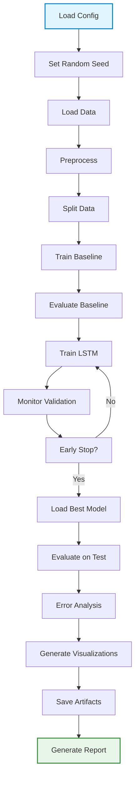
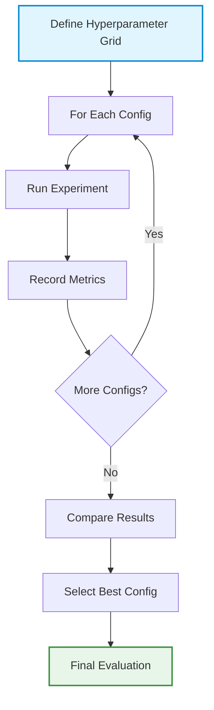

# Experimentation, Evaluation & Reproducibility Plan

> **Status note (2026-10-11):** This document began as a prospective plan and contains historical design proposals that are not all implemented. It is not the canonical description of current experiments. For measured baseline results, see [RESULTS.md](RESULTS.md); for implemented reliability protocols and the exact reproduction command, see [RELIABILITY_AND_ROBUSTNESS.md](RELIABILITY_AND_ROBUSTNESS.md). The status table and observed outcome below describe the baseline pipeline only. Aspirational thresholds and items labeled optional/future are not achieved results.

## 1. Experimental Objectives

### 1.1 Primary Objective

Develop and evaluate an LSTM-based model for turbofan engine RUL prediction that achieves competitive performance on all NASA C-MAPSS benchmark datasets (FD001, FD002, FD003, FD004).

### 1.2 Secondary Objectives

- Establish a reproducible experimental pipeline
- Compare LSTM performance against a simple baseline
- Analyze prediction errors across degradation stages
- Evaluate model generalization to unseen engines
- Document hyperparameter sensitivity

### 1.3 Success Criteria

- LSTM model outperforms baseline on MAE for all subsets
- Test set MAE is competitive with literature values for FD001, FD002, FD003, FD004
- Experiments are reproducible from documentation
- Code and artifacts are properly versioned
- Results demonstrate generalization across different operating conditions and fault modes

---

## 2. Baseline Model

### 2.1 Baseline Selection

**Primary Baseline**: Linear Regression on aggregated features

**Rationale**:
- Simple, interpretable model
- Establishes performance floor
- Fast to train and evaluate
- Common baseline in literature

### 2.2 Baseline Implementation

**Feature Aggregation**:
- For each sequence, compute mean of each sensor over the window
- Input: `(n_sequences, n_features)` aggregated features
- Output: RUL at last cycle of window

**Model**: `sklearn.linear_model.LinearRegression`

**Training**:
- Fit on training sequences
- Evaluate on validation and test sets

**Metrics**: MAE, RMSE

### 2.3 Alternative Baselines (Optional)

**Persistence Model**: Predict last observed RUL in training window
**Mean Model**: Predict mean training RUL for all samples
**Random Forest**: Tree-based baseline for comparison

**Status**: Linear regression baseline required, others optional

---

## 3. Primary LSTM Architecture

### 3.1 Baseline Architecture

**Input Layer**: `(window_size, n_features)`

**LSTM Layers**:
- Layer 1: LSTM(64 units, return_sequences=True)
- Dropout(0.2)
- Layer 2: LSTM(32 units, return_sequences=False)
- Dropout(0.2)

**Dense Layers**:
- Dense(16 units, activation='relu')
- Dense(1 unit) - output

**Total Parameters**: ~15,000-20,000 (estimated)

### 3.2 Architecture Rationale

**Two LSTM Layers**:
- First layer captures temporal patterns
- Second layer abstracts higher-level features
- return_sequences=True allows stacking

**Dropout**:
- Prevents overfitting
- Rate 0.2 is standard starting point

**Dense Layer**:
- Non-linear transformation before output
- 16 units provides capacity without overfitting

**Output Layer**:
- Single neuron for regression
- No activation (linear output for unbounded RUL)

### 3.3 Alternative Architectures (Future)

**Bidirectional LSTM**: Capture past and future context (not appropriate for RUL prediction)
**GRU**: Simpler recurrent unit, faster training
**1D CNN + LSTM**: Convolutional feature extraction before LSTM
**Attention Mechanism**: Focus on important time steps

**Status**: Baseline architecture defined, alternatives for future experiments

---

## 4. Candidate Alternative Models (Optional)

### 4.1 GRU Alternative

**Architecture**: Same as LSTM but with GRU layers

**Rationale**:
- Simpler than LSTM, faster training
- Often performs similarly on time-series tasks

**Status**: Optional extension

### 4.2 CNN-LSTM Hybrid

**Architecture**: 1D CNN layers followed by LSTM

**Rationale**:
- CNN extracts local patterns
- LSTM captures temporal dependencies
- May improve performance

**Status**: Optional extension

### 4.3 XGBoost on Aggregated Features

**Architecture**: XGBoost regressor on window-aggregated features

**Rationale**:
- Tree-based alternative to LSTM
- Strong baseline for tabular data

**Status**: Optional extension

---

## 5. Hyperparameters

### 5.1 Data Hyperparameters

| Hyperparameter | Default Value | Type | Description |
|---------------|---------------|------|-------------|
| dataset | FD001 | string | Dataset subset |
| window_size | 30 | integer | Sequence length |
| remove_constant_sensors | True | boolean | Remove constant sensors |
| normalize | True | boolean | Apply normalization |
| scaler_type | minmax | string | Scaler type (minmax/standard) |
| clip_rul | False | boolean | Clip RUL values |
| rul_clip_value | 125 | integer | RUL clip threshold |
| train_ratio | 0.8 | float | Training engine ratio |
| val_ratio | 0.1 | float | Validation engine ratio |

### 5.2 Model Hyperparameters

| Hyperparameter | Default Value | Type | Description |
|---------------|---------------|------|-------------|
| lstm_units | [64, 32] | list | LSTM units per layer |
| dropout_rate | 0.2 | float | Dropout probability |
| dense_units | 16 | integer | Dense layer units |
| activation | relu | string | Dense layer activation |

### 5.3 Training Hyperparameters

| Hyperparameter | Default Value | Type | Description |
|---------------|---------------|------|-------------|
| learning_rate | 0.001 | float | Optimizer learning rate |
| batch_size | 64 | integer | Training batch size |
| max_epochs | 100 | integer | Maximum training epochs |
| early_stopping_patience | 10 | integer | Epochs to wait for improvement |
| optimizer | adam | string | Optimizer (adam/rmsprop) |
| loss | mse | string | Loss function (mse/mae) |

### 5.4 Reproducibility Hyperparameters

| Hyperparameter | Default Value | Type | Description |
|---------------|---------------|------|-------------|
| random_seed | 42 | integer | Random seed for all stochastic operations |

---

## 6. Training Configuration

### 6.1 Optimizer

**Selection**: Adam

**Rationale**:
- Adaptive learning rate
- Works well for LSTM
- Standard choice in deep learning

**Learning Rate**: 0.001 (default Adam learning rate)

**Alternatives**: RMSprop, SGD with momentum

### 6.2 Loss Function

**Selection**: Mean Squared Error (MSE)

**Rationale**:
- Standard regression loss
- Differentiable
- Penalizes large errors heavily

**Alternative**: Mean Absolute Error (MAE) - less sensitive to outliers

### 6.3 Batch Size

**Default**: 64

**Rationale**:
- Balance between gradient stability and memory usage
- Common default value
- Fits in GPU memory if available

**Alternatives**: 32, 128 (can experiment)

### 6.4 Epochs

**Maximum**: 100

**Early Stopping**: Patience 10 epochs

**Rationale**:
- 100 epochs sufficient for convergence
- Early stopping prevents overfitting
- Monitors validation loss

---

## 7. Validation Strategy

### 7.1 Validation Set

**Purpose**: 
- Monitor training progress
- Early stopping decisions
- Hyperparameter tuning

**Size**: 20% of the supplied training engines (20 engines for FD001); the official test engines remain untouched for final evaluation.

**Split Method**: Engine-level split (see DATASET_AND_DATA_PIPELINE.md)

**Usage**:
- Compute validation metrics each epoch
- Save model checkpoint on validation loss improvement
- Trigger early stopping if no improvement for patience epochs

### 7.2 Validation Metrics

**Primary Metric**: Validation MAE

**Secondary Metric**: Validation RMSE

**Monitoring**: Track each epoch

**Decision Making**:
- Early stopping based on validation MAE
- Model selection based on best validation MAE

---

## 8. Early Stopping

### 8.1 Implementation

**Patience**: 10 epochs

**Monitor**: Validation MAE

**Mode**: Minimize (lower is better)

**Restore Best Weights**: Yes

**Implementation** (TensorFlow/Keras):
```python
from tensorflow.keras.callbacks import EarlyStopping

early_stopping = EarlyStopping(
    monitor='val_mae',
    patience=10,
    restore_best_weights=True,
    mode='min'
)
```

### 8.2 Rationale

**Prevents Overfitting**: Stops training when validation performance degrades

**Saves Time**: Avoids unnecessary epochs

**Best Model**: Restores weights from best epoch

---

## 9. Checkpointing

### 9.1 Model Checkpointing

**Purpose**: Save best model during training

**Monitor**: Validation MAE

**Save Best Only**: Yes

**Filename**: `lstm_model_fd001_{config_hash}.h5`

**Implementation** (TensorFlow/Keras):
```python
from tensorflow.keras.callbacks import ModelCheckpoint

checkpoint = ModelCheckpoint(
    filepath='models/lstm_model_fd001_{hash}.h5',
    monitor='val_mae',
    save_best_only=True,
    mode='min'
)
```

### 9.2 Training History

**Save**: Training and validation loss per epoch

**Format**: JSON file

**Filename**: `training_history_fd001_{config_hash}.json`

**Content**:
```json
{
  "loss": [0.5, 0.4, 0.35, ...],
  "val_loss": [0.6, 0.5, 0.45, ...],
  "mae": [0.4, 0.35, 0.3, ...],
  "val_mae": [0.5, 0.4, 0.38, ...]
}
```

---

## 10. Random Seed Strategy

### 10.1 Seed Setting

**Seed**: 42 (configurable)

**Scope**: All stochastic operations

**Implementation**:
```python
import random
import numpy as np
import tensorflow as tf

def set_seed(seed=42):
    random.seed(seed)
    np.random.seed(seed)
    tf.random.set_seed(seed)
```

### 10.2 Deterministic Behavior

**Affected Operations**:
- Data splitting (engine shuffle)
- Model weight initialization
- Dropout during training (if using TensorFlow deterministic ops)
- Any random sampling

**Note**: Complete determinism in TensorFlow requires additional configuration (GPU operations may still have non-determinism)

---

## 11. Experiment Naming

### 11.1 Configuration Hash

**Method**: SHA-256 hash of all hyperparameters

**Implementation**:
```python
import hashlib
import json

def compute_config_hash(config):
    config_dict = {k: v for k, v in config.__dict__.items() if not k.startswith('_')}
    config_str = json.dumps(config_dict, sort_keys=True)
    return hashlib.sha256(config_str.encode()).hexdigest()[:16]
```

**Example**: `99c7a6631340d301`

### 11.2 Experiment Identification

**Format**: `{dataset}_{config_hash}`

**Example**: `FD001_99c7a6631340d301`

**Usage**:
- Model filename: `lstm_model_FD001_99c7a6631340d301.h5`
- Directory: `outputs/FD001_99c7a6631340d301/`
- Report: `analysis_summary_FD001_99c7a6631340d301.md`

---

## 12. Experiment Tracking

### 12.1 Metadata Logging

**Content**:
- Configuration hash
- All hyperparameters
- Package versions
- Timestamp
- Dataset information
- Training metrics
- Test metrics
- Hardware information (optional)

**Format**: JSON

**Filename**: `experiment_metadata_FD001_{config_hash}.json`

**Location**: `models/`

### 12.2 Package Version Logging

**Implementation**:
```python
import pkg_resources

def get_package_versions():
    packages = ['pandas', 'numpy', 'scikit-learn', 'tensorflow', 'matplotlib']
    return {pkg: pkg_resources.get_distribution(pkg).version for pkg in packages}
```

**Purpose**: Reproducibility across environments

---

## 13. Metrics

### 13.1 Primary Metrics

**Mean Absolute Error (MAE)**:
```python
MAE = mean(|y_true - y_pred|)
```
- Interpretation: Average absolute error in cycles
- Robust to outliers
- Primary metric for model selection

**Root Mean Square Error (RMSE)**:
```python
RMSE = sqrt(mean((y_true - y_pred)^2))
```
- Interpretation: Square root of average squared error
- Penalizes large errors more heavily
- Secondary metric

### 13.2 Secondary Metrics (Optional)

**R² Score**:
```python
R² = 1 - (sum((y_true - y_pred)^2) / sum((y_true - mean(y_true))^2))
```
- Interpretation: Proportion of variance explained
- Range: (-∞, 1], higher is better

**Mean Absolute Percentage Error (MAPE)**:
```python
MAPE = mean(|(y_true - y_pred) / y_true|) * 100
```
- Interpretation: Average percentage error
- Issue: Undefined when y_true = 0

**Status**: MAE and RMSE required, others optional

### 13.3 Metric Computation

**Implementation**:
```python
from sklearn.metrics import mean_absolute_error, mean_squared_error
import numpy as np

def compute_metrics(y_true, y_pred):
    mae = mean_absolute_error(y_true, y_pred)
    rmse = np.sqrt(mean_squared_error(y_true, y_pred))
    return {'mae': mae, 'rmse': rmse}
```

---

## 14. Error Analysis

### 14.1 Error Distribution

**Analysis**:
- Histogram of prediction errors (y_pred - y_true)
- Check for systematic bias (mean ≠ 0)
- Check for heteroscedasticity (variance changes with RUL)

**Visualization**: Error histogram with mean and std marked

### 14.2 Error vs RUL

**Analysis**:
- Scatter plot of error vs true RUL
- Check if errors are larger at certain RUL ranges
- Identify if model struggles with early or late degradation

**Visualization**: Error vs RUL scatter plot with trend line

### 14.3 Per-Engine Analysis

**Analysis**:
- Compute MAE per engine
- Identify engines with poor predictions
- Check if certain engines are systematically difficult

**Visualization**: Boxplot of per-engine MAE, highlight outliers

### 14.4 Residual Analysis

**Analysis**:
- Residuals vs predicted values
- Q-Q plot for normality
- Autocorrelation of residuals

**Purpose**: Check regression assumptions

---

## 15. Prediction Visualization

### 15.1 Predicted vs Actual Scatter

**Plot**: Scatter plot of predicted RUL vs actual RUL

**Ideal**: Points lie on y=x diagonal

**Metrics**: Add R² and correlation coefficient

**Purpose**: Visual assessment of prediction accuracy

### 15.2 Sample Engine Trajectories

**Plot**: For selected test engines:
- True RUL over cycles
- Predicted RUL over cycles
- Sensor degradation with RUL overlay

**Purpose**: Visualize how model tracks degradation

### 15.3 Training Curves

**Plot**: 
- Training loss vs epochs
- Validation loss vs epochs
- Training MAE vs epochs
- Validation MAE vs epochs

**Purpose**: Monitor training progress, detect overfitting

### 15.4 Error Distribution

**Plot**: Histogram of prediction errors

**Purpose**: Assess error distribution, identify bias

---

## 16. Residual/Error Analysis

### 16.1 Residual Definition

**Residual**: `residual = y_true - y_pred`

**Properties**:
- Mean should be near 0 (unbiased)
- Variance should be consistent
- No patterns in residuals vs predicted

### 16.2 Analysis Methods

**Residual vs Fitted Plot**:
- Check for patterns
- Ideal: Random scatter around 0

**Q-Q Plot**:
- Check normality of residuals
- Ideal: Points on diagonal line

**Autocorrelation**:
- Check for temporal correlation in residuals
- Should be minimal for good model

---

## 17. Engine-Level Analysis

### 17.1 Per-Engine Metrics

**Computation**:
```python
per_engine_mae = df.groupby('unit').apply(
    lambda x: mean_absolute_error(x['RUL'], x['predicted_RUL'])
)
```

**Analysis**:
- Distribution of per-engine MAE
- Identify worst-performing engines
- Check if certain engine characteristics cause poor predictions

### 17.2 Engine Characteristics

**Investigate**:
- Do engines with short life have different error patterns?
- Do engines with long life have different error patterns?
- Is error correlated with total cycles?

---

## 18. Generalization Analysis

### 18.1 Train vs Validation vs Test Performance

**Compare**:
- Training MAE
- Validation MAE
- Test MAE

**Interpretation**:
- Train << Val: Overfitting
- Train ≈ Val << Test: Poor generalization
- Train ≈ Val ≈ Test: Good generalization

### 18.2 Cross-Validation (Optional)

**Method**: K-fold cross-validation at engine level

**Purpose**: More robust performance estimate

**Implementation**: Future work, not required for baseline

---

## 19. Ablation Experiments

### 19.1 Window Size Ablation

**Hypothesis**: Window size affects performance

**Experiment**: Test window sizes [10, 20, 30, 50, 100]

**Metrics**: Compare test MAE across window sizes

**Status**: Optional extension

### 19.2 Feature Set Ablation

**Hypothesis**: Feature selection affects performance

**Experiments**:
- All sensors vs selected sensors
- With vs without operational settings
- Raw sensors vs rolling statistics

**Status**: Optional extension

### 19.3 Architecture Ablation

**Hypothesis**: Architecture complexity affects performance

**Experiments**:
- 1 LSTM layer vs 2 LSTM layers
- With vs without dropout
- Different unit counts

**Status**: Optional extension

### 19.4 RUL Clipping Ablation

**Hypothesis**: RUL clipping affects performance

**Experiment**: Test clip values [None, 50, 100, 125, 150]

**Status**: Optional extension

---

## 20. Model Comparison

### 20.1 LSTM vs Baseline

**Comparison Metrics**:
- Test MAE
- Test RMSE
- Training time
- Inference time

**Visualization**: Bar chart comparing metrics

**Expected Result**: LSTM should outperform baseline

### 20.2 LSTM vs Alternative Models (Optional)

**Models**: GRU, CNN-LSTM, XGBoost

**Comparison**: Same metrics, same data splits

**Status**: Optional extension

---

## 21. Reproducibility Procedure

### 21.1 Step-by-Step Reproduction

**1. Environment Setup**:
```bash
python --version  # Should be 3.12+
pip install -r requirements.txt
```

**2. Dataset Download**:
```bash
# Download NASA C-MAPSS FD001 files to data/
# Or use provided download script
```

**3. Run Experiment**:
```bash
python src/pipeline.py --config config.yaml
```

**4. Verify Results**:
- Check outputs match expected metrics
- Check configuration hash matches
- Check package versions match metadata

### 21.2 Reproducibility Checklist

- [ ] Random seed fixed
- [ ] Configuration hash computed
- [ ] Package versions logged
- [ ] Data split deterministic
- [ ] Model initialization deterministic
- [ ] All artifacts saved with metadata
- [ ] Complete documentation provided

---

## 22. Expected Artifacts

### 22.1 Model Artifacts

**Files**:
- `models/lstm_model_FD001_{config_hash}.h5` - Trained model
- `models/scaler.pkl` - Fitted scaler
- `models/constant_sensors.json` - List of removed sensors
- `models/feature_columns.json` - Feature column names
- `models/preprocessing_metadata.json` - Preprocessing config

### 22.2 Training Artifacts

**Files**:
- `models/training_history_FD001_{config_hash}.json` - Loss curves
- `models/experiment_metadata_FD001_{config_hash}.json` - Full metadata

### 22.3 Evaluation Artifacts

**Files**:
- `outputs/metrics/test_metrics_FD001_{config_hash}.json` - Test metrics
- `outputs/metrics/validation_metrics_FD001_{config_hash}.json` - Validation metrics
- `outputs/metrics/baseline_metrics_FD001_{config_hash}.json` - Baseline metrics

### 22.4 Visualization Artifacts

**Files**:
- `outputs/figures/eda/sensor_timeseries.png`
- `outputs/figures/eda/correlations.png`
- `outputs/figures/eda/rul_distribution.png`
- `outputs/figures/training/loss_curves.png`
- `outputs/figures/performance/predicted_vs_actual.png`
- `outputs/figures/performance/residuals.png`
- `outputs/figures/error_analysis/error_vs_rul.png`
- `outputs/figures/error_analysis/per_engine_errors.png`

### 22.5 Report Artifacts

**Files**:
- `outputs/reports/analysis_summary_FD001_{config_hash}.md` - Main report
- `outputs/reports/error_analysis_FD001_{config_hash}.md` - Error analysis

---

## 23. Acceptance Thresholds

### 23.1 Baseline Performance

**Requirement**: LSTM must outperform baseline

**Metric**: Test MAE

**Threshold**: LSTM MAE < Baseline MAE

### 23.2 Absolute Performance

**Target**: Competitive with literature values for FD001

**Literature Reference**: Typical FD001 MAE ranges from 15-30 cycles depending on approach

**Target**: MAE < 30 cycles (reasonable target for baseline LSTM)

**Note**: Exact threshold depends on implementation; this is a guideline

### 23.3 Overfitting Check

**Requirement**: Validation and test performance should be similar

**Metric**: Ratio of test MAE to validation MAE

**Threshold**: test_MAE / val_MAE < 1.5

**Rationale**: Large gap indicates overfitting

### 23.4 Convergence

**Requirement**: Model should converge within max epochs

**Metric**: Training loss should plateau

**Threshold**: Early stopping should trigger before max_epochs (or loss should stabilize)

---

## 24. Experimental Workflow

### 24.1 Single Experiment Workflow



### 24.2 Hyperparameter Tuning Workflow (Optional)



---

## 25. Reporting

### 25.1 Analysis Summary Report

**Sections**:
1. Experiment configuration (hash, hyperparameters)
2. Dataset information (subset, engines, cycles)
3. Model architecture
4. Training summary (epochs, convergence)
5. Validation metrics
6. Test metrics
7. Comparison with baseline
8. Key findings
9. Error analysis summary
10. Figures (embedded or referenced)

**Format**: Markdown

**Location**: `outputs/reports/analysis_summary_FD001_{config_hash}.md`

### 25.2 Error Analysis Report

**Sections**:
1. Error distribution statistics
2. Error vs RUL analysis
3. Per-engine error analysis
4. Systematic biases
5. Recommendations

**Format**: Markdown

**Location**: `outputs/reports/error_analysis_FD001_{config_hash}.md`

---

## 26. Implementation Status

| Component | Status | Notes |
|-----------|--------|-------|
| Experimental scope | Implemented | FD001-FD004 with a separate pipeline per subset |
| Baseline | Implemented | Ridge regression on window summary features |
| Primary sequence model | Implemented | Stacked 64/32-unit many-to-one LSTM with dropout |
| Training | Implemented | Adam, MSE, batch size 64, early stopping on validation MAE |
| Validation strategy | Implemented | Engine-level 80/20 split of training engines |
| Reproducibility | Implemented | Seeded Python/NumPy/TensorFlow runs; configuration and package versions recorded |
| Model selection | Implemented | Minimum validation MAE; official test is not used for selection |
| Core metrics | Implemented | MAE, RMSE, R-squared, median absolute error, and asymmetric score |
| Uncertainty | Implemented | Validation-calibrated split-conformal intervals and observed test coverage |
| Error/robustness analysis | Implemented | Per-engine errors, Tukey outliers, bias, residual figures |
| Research methods | Implemented | Sensor/PCA screening, detrending, fractional-life metrics, cross-subset transfer |
| Visualization | Implemented | Matplotlib figures for training, predictions, residuals, intervals, and sensors |
| Results artifacts | Implemented | JSON metrics, predictions, figures, Markdown run summaries under `outputs/` |
| Optional architectures/ablations | Not implemented | GRU, CNN-LSTM, and systematic hyperparameter search remain out of scope |

### Observed Outcome

The completed 20-epoch run does **not** meet the aspirational success criterion that the LSTM outperform the baseline on every subset: validation-based selection chose the LSTM only for FD001 and Ridge for FD002-FD004. On FD003 the LSTM's test MAE is lower, but Ridge remains selected because its validation MAE was lower. The model was not selected using test results. See the [measured results report](RESULTS.md) for per-model scores, research analyses, and protocol limits.

---

## 27. Key Experimental Decisions Summary

### 27.1 Baseline

**Decision**: Ridge regression on window summary features

**Rationale**: A regularized, reproducible tabular baseline for the same 30-cycle windows.

### 27.2 Primary Architecture

**Decision**: Stacked LSTM (64, 32 units) with dropout and a 16-unit dense layer

**Rationale**: Many-to-one regression from each sensor window to its end-of-window RUL label.

### 27.3 Metrics

**Decision**: MAE (primary), RMSE (secondary)

**Rationale**: MAE interpretable, RMSE penalizes large errors

### 27.4 Validation

**Decision**: Engine-level split, early stopping on val MAE

**Rationale**: Prevents leakage, prevents overfitting

### 27.5 Reproducibility

**Decision**: Fixed random seed and run metadata logging

**Rationale**: Improves repeatability; TensorFlow kernels and package/platform differences mean bitwise-identical results are not guaranteed.

---

**Document Version**: 1.1  
**Last Updated**: 2026-10-11  
**Status**: Implemented experiment workflow; generated run outputs are local and reproducible with `python -m src.train_all`.
