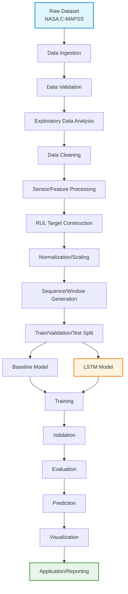
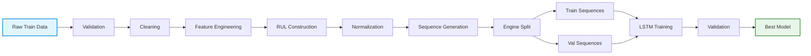
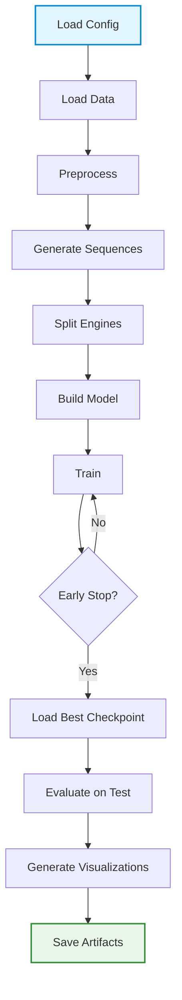
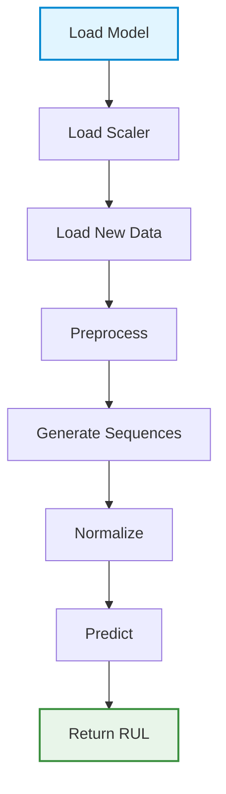
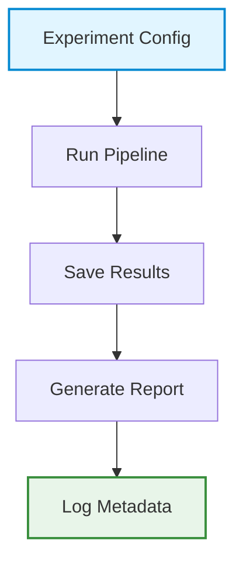
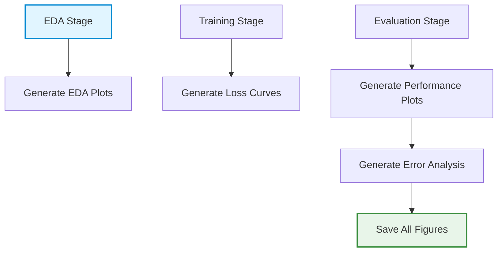
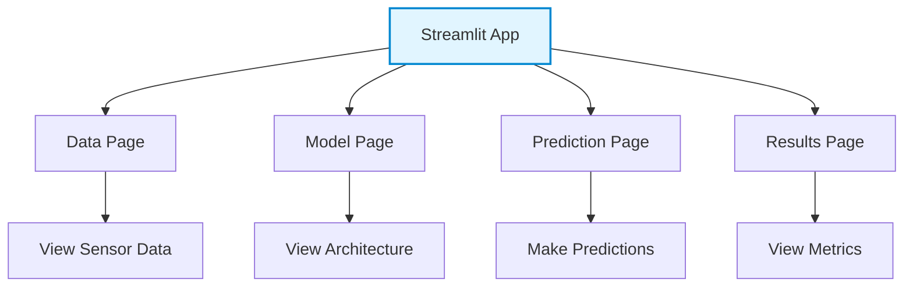
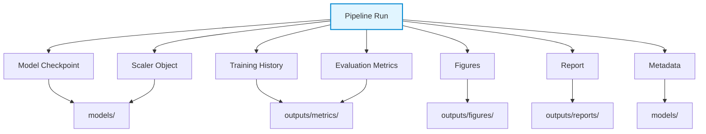
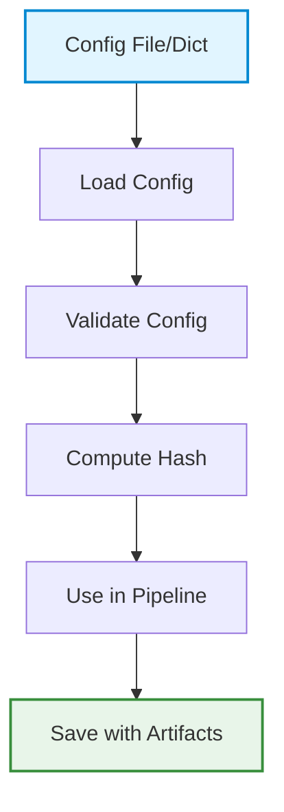

# System / ML Architecture

> **Current implementation:** The module map and workflow below describe the code that runs today. Later detailed sections are retained as design context; where they differ, the current pipeline and [`turbofan-pipeline.html`](turbofan-pipeline.html) are authoritative.

## Current Data and Application Flow

`Ref/CMAPSSData/` -> `DataLoader` / `DataValidator` -> per-engine capped RUL labels -> engine-level train/validation split -> training-only constant-sensor filtering and MinMax scaling -> 30-cycle windows -> Ridge and optional TensorFlow LSTM -> validation-MAE selection -> official test metrics, conformal intervals, and error summaries -> Matplotlib figures, JSON/CSV/Markdown artifacts -> Streamlit and React dashboards.

The official test set is never used to fit the scaler or select a model. Research analyses add training-only sensor/PCA screening, polynomial trend summaries, fractional-life stage comparisons, and source-to-target/pooled transfer between FD001-FD004. Fractional life is a proxy, since C-MAPSS has no overhaul timestamps. Subset transfer is a simulated proxy-domain study, not real fleet transfer.

| Boundary | Current implementation |
|---|---|
| Configuration and paths | `src/config.py`; finds bundled data or honors `CMAPSS_DATA_DIR` |
| Loading, targets, and validation | `src/data_loader.py`, `src/target_construction.py`, `src/data_validator.py` |
| Split and preprocessing | `src/data_splitter.py`, `src/data_cleaner.py`, `src/normalization.py`, `src/sequence_generator.py` |
| Models and orchestration | `src/baseline_model.py`, `src/lstm_model.py`, `src/trainer.py`, `src/pipeline.py`, `src/train_all.py` |
| Evaluation and analysis | `src/evaluator.py`, `src/uncertainty.py`, `src/research_analysis.py`, `src/transfer_analysis.py`, `src/segmentation_analysis.py`, `src/detrending.py` |
| Figures and applications | `src/visualizer.py`, `src/streamlit_dashboard.py`, `web/src/main.jsx` |

Generated model weights and experiment outputs live under `models/` and `outputs/`; both are intentionally git-ignored. The static web bundle in `web/public/results/` is refreshed by `scripts/export_web_data.py`.

## 1. High-Level Architecture

The system implements a complete machine learning pipeline for turbofan engine Remaining Useful Life (RUL) prediction using LSTM networks. The architecture follows a modular, stage-based design that transforms raw sensor time-series data into RUL predictions through a series of well-defined processing stages.



## 2. Detailed ML Pipeline

### 2.1 Pipeline Stages

#### Stage 1: Data Ingestion
**Responsibility**: Load raw NASA C-MAPSS dataset files into structured dataframes.

**Input**: 
- `train_FD001.txt` (or other subset)
- `test_FD001.txt`
- `RUL_FD001.txt`

**Output**: 
- Raw training dataframe (unit, cycle, settings, sensors)
- Raw test dataframe
- Ground truth RUL for test engines

**Key Operations**:
- Parse space-separated text files
- Assign column names (unit, cycle, setting_1, setting_2, setting_3, sensor_1...sensor_21)
- Validate file structure and data types
- Log dataset statistics (number of engines, cycles, sensors)

**Module**: `data_loader.py`

---

#### Stage 2: Data Validation
**Responsibility**: Validate data integrity and identify quality issues.

**Input**: Raw dataframes from Stage 1

**Output**: Validation report, cleaned dataframes

**Key Operations**:
- Check for missing values
- Validate data types (numeric for all columns)
- Check for duplicate records
- Identify constant/near-constant sensors
- Validate RUL file format
- Log data quality metrics

**Module**: `data_validator.py`

---

#### Stage 3: Exploratory Data Analysis (EDA)
**Responsibility**: Characterize sensor behavior and degradation patterns.

**Input**: Validated dataframes

**Output**: EDA report, visualizations, sensor statistics

**Key Operations**:
- Compute sensor statistics (mean, std, min, max per engine)
- Plot sensor time-series for sample engines
- Analyze sensor correlations
- Examine RUL distribution
- Identify degradation trends
- Generate EDA figures

**Module**: `eda.py`

**Outputs**: Saved to `outputs/figures/eda/`

---

#### Stage 4: Data Cleaning
**Responsibility**: Handle identified data quality issues.

**Input**: Validated dataframes, validation report

**Output**: Cleaned dataframes

**Key Operations**:
- Remove or impute missing values (if any)
- Handle constant/near-constant sensors (drop or flag)
- Validate sensor ranges
- Ensure temporal ordering within engines

**Module**: `data_cleaner.py`

---

#### Stage 5: Sensor/Feature Processing
**Responsibility**: Engineer features from raw sensor data.

**Input**: Cleaned dataframes

**Output**: Feature dataframe

**Key Operations**:
- **Baseline**: Use raw sensor readings as features
- **Optional**: Compute rolling statistics (mean, std over window)
- **Optional**: Compute sensor degradation rates
- **Optional**: Feature selection based on EDA insights

**Module**: `feature_engineering.py`

**Design Decision**: For baseline implementation, use raw sensors directly. Rolling statistics can be added as an extension.

---

#### Stage 6: RUL Target Construction
**Responsibility**: Compute RUL labels for training and test data.

**Input**: Cleaned dataframes, ground truth RUL for test

**Output**: Dataframes with RUL column

**Key Operations**:

**Training Data**:
```
RUL = max_cycle_for_engine - current_cycle
```

**Test Data**:
```
row_RUL = max_test_cycle_for_engine - current_cycle + final_RUL
```
where `final_RUL` is from `RUL_FD001.txt`

**Module**: `target_construction.py`

**Critical Note**: RUL is computed per-engine, not globally. Each engine has its own max cycle.

---

#### Stage 7: Normalization/Scaling
**Responsibility**: Scale features to appropriate ranges for LSTM training.

**Input**: Feature dataframe with RUL

**Output**: Scaled features, scaler objects

**Key Operations**:
- Fit scaler on training data only
- Apply same scaler to validation and test data
- Consider MinMaxScaler (0-1 range) or StandardScaler (z-score)
- Save scaler for inference reproducibility

**Module**: `normalization.py`

**Design Decision MinMaxScaler is recommended for LSTM to keep values in [0,1] range, which helps with gradient stability.

---

#### Stage 8: Sequence/Window Generation
**Responsibility**: Convert time-series data into sequences for LSTM input.

**Input**: Scaled feature dataframe

**Output**: Sequence arrays (X, y) for train/validation/test

**Key Operations**:
- For each engine, generate sliding windows of length `window_size`
- X shape: `(n_sequences, window_size, n_features)`
- y shape: `(n_sequences,)` - RUL at last timestep of window
- Handle variable-length sequences (last window may be shorter)
- Ensure no leakage between engines

**Module**: `sequence_generator.py`

**Example**:
```
Window size = 30
Engine 1, cycles 1-100:
  Sequence 1: cycles 1-30 → RUL at cycle 30
  Sequence 2: cycles 2-31 → RUL at cycle 31
  ...
  Sequence 71: cycles 71-100 → RUL at cycle 100
```

**Critical**: Sequences are generated per-engine. Do not mix cycles from different engines in a single sequence.

---

#### Stage 9: Train/Validation/Test Strategy
**Responsibility**: Split engines into train/validation/test sets.

**Input**: Sequence arrays

**Output**: Split sequence arrays

**Key Operations**:
- **Engine-level split**: Split engines, not rows
- Example: 80% engines for training, 10% for validation, 10% for test
- Validation set used for early stopping and hyperparameter tuning
- Test set held out completely until final evaluation
- Stratified split optional (by RUL distribution or fault mode)

**Module**: `data_splitter.py`

**Critical**: Random row-level splitting is inappropriate because it would leak future information from the same engine into training data.

**Split Example (FD001 - 100 train engines)**:
- Train: 80 engines (sequences from these engines)
- Validation: 10 engines
- Test: 10 engines (original test set is separate)

---

#### Stage 10: Baseline Model
**Responsibility**: Implement simple baseline for comparison.

**Input**: Training sequences, validation sequences

**Output**: Baseline predictions, baseline metrics

**Approaches**:
1. **Linear Regression**: On aggregated features (mean sensor values per sequence)
2. **Persistence Model**: Predict last observed RUL in window
3. **Mean Model**: Predict mean training RUL

**Module**: `baseline_model.py`

**Purpose**: Establish performance floor. LSTM should outperform baseline.

---

#### Stage 11: LSTM Model
**Responsibility**: Define and implement LSTM architecture.

**Input**: Training sequences

**Output**: LSTM model object

**Architecture Components**:
- Input layer: `(window_size, n_features)`
- LSTM layers: 1-3 layers with configurable units
- Dropout layers for regularization
- Dense layers for feature transformation
- Output layer: single neuron (RUL prediction)

**Module**: `lstm_model.py`

**Example Architecture**:
```
Input (30, 21)
↓
LSTM(64, return_sequences=True)
↓
Dropout(0.2)
↓
LSTM(32)
↓
Dropout(0.2)
↓
Dense(16, activation='relu')
↓
Dense(1)
```

---

#### Stage 12: Training
**Responsibility**: Train LSTM model with validation monitoring.

**Input**: LSTM model, train sequences, validation sequences

**Output**: Trained model, training history

**Key Operations**:
- Compile model with optimizer (Adam) and loss (MSE)
- Train for specified epochs with batch size
- Monitor validation loss
- Implement early stopping (patience parameter)
- Implement model checkpointing (save best model)
- Optional: Learning rate scheduling

**Module**: `trainer.py`

**Training Loop**:
```python
for epoch in range(max_epochs):
    train_one_epoch()
    validate()
    if val_loss improved:
        save_checkpoint()
    if early_stopping_triggered:
        break
```

---

#### Stage 13: Validation
**Responsibility**: Monitor training progress and prevent overfitting.

**Input**: Training history, validation predictions

**Output**: Validation metrics, early stopping decisions

**Key Operations**:
- Compute validation MAE, RMSE each epoch
- Track best validation performance
- Implement early stopping logic
- Generate validation prediction plots

**Module**: `validator.py`

---

#### Stage 14: Evaluation
**Responsibility**: Evaluate final model on held-out test set.

**Input**: Trained model, test sequences

**Output**: Test metrics, prediction analysis

**Key Operations**:
- Load best checkpoint
- Generate predictions on test set
- Compute MAE, RMSE
- Compare with baseline
- Engine-level error analysis
- Error distribution analysis

**Module**: `evaluator.py`

---

#### Stage 15: Prediction
**Responsibility**: Generate predictions for new engines.

**Input**: Trained model, new engine data

**Output**: RUL predictions

**Key Operations**:
- Apply same preprocessing pipeline
- Generate sequences
- Scale using saved scaler
- Predict using loaded model
- Return RUL values

**Module**: `predictor.py`

---

#### Stage 16: Visualization
**Responsibility**: Generate comprehensive visualizations.

**Input**: Model results, evaluation metrics

**Output**: Figures saved to `outputs/figures/`

**Visualizations**:
1. **EDA**: Sensor time-series, correlations, RUL distribution
2. **Training**: Loss curves (train/val)
3. **Performance**: Predicted vs actual scatter, residual plots
4. **Degradation**: Sensor trajectories with RUL overlay
5. **Error Analysis**: Error vs RUL, error per engine

**Module**: `visualizer.py`

---

#### Stage 17: Application/Reporting
**Responsibility**: Provide interactive exploration and reporting.

**Input**: Model artifacts, evaluation results

**Output**: Streamlit app, analysis report

**Components**:
- Streamlit dashboard for interactive exploration
- Markdown report with results summary
- Export predictions to CSV
- Export model for inference

**Module**: `streamlit_app.py`, `report_generator.py`

---

## 3. Data Flow

### 3.1 Training Data Flow



### 3.2 Inference Data Flow


---

## 4. Module Responsibilities

### 4.1 Core Pipeline Modules

| Module | Responsibility | Input | Output |
|--------|---------------|-------|--------|
| `data_loader.py` | Load raw dataset | File paths | Dataframes |
| `data_validator.py` | Validate data quality | Dataframes | Validation report |
| `eda.py` | Exploratory analysis | Dataframes | EDA figures, stats |
| `data_cleaner.py` | Clean data | Dataframes | Cleaned dataframes |
| `feature_engineering.py` | Engineer features | Dataframes | Feature dataframe |
| `target_construction.py` | Compute RUL labels | Dataframes | Dataframes with RUL |
| `normalization.py` | Scale features | Dataframes | Scaled data, scaler |
| `sequence_generator.py` | Generate sequences | Scaled data | Sequence arrays |
| `data_splitter.py` | Split engines | Sequences | Train/val/test splits |
| `baseline_model.py` | Baseline predictions | Splits | Baseline metrics |
| `lstm_model.py` | Define architecture | Config | Model object |
| `trainer.py` | Train model | Model, splits | Trained model, history |
| `validator.py` | Monitor training | History | Validation metrics |
| `evaluator.py` | Evaluate model | Model, test | Test metrics, analysis |
| `predictor.py` | Generate predictions | New data, model | RUL predictions |
| `visualizer.py` | Generate figures | Results | Figure files |
| `report_generator.py` | Create reports | Results | Markdown reports |

### 4.2 Orchestration Module

| Module | Responsibility |
|--------|---------------|
| `pipeline.py` | Main orchestration - runs all stages in order |
| `config.py` | Configuration management |
| `paths.py` | Path management (similar to reference project) |

---

## 5. Component Boundaries

### 5.1 Data Layer
- Handles all I/O operations
- No ML logic
- Modules: `data_loader.py`, `data_validator.py`, `data_cleaner.py`

### 5.2 Feature Layer
- Transforms raw data into model-ready features
- No model-specific logic
- Modules: `feature_engineering.py`, `target_construction.py`, `normalization.py`, `sequence_generator.py`

### 5.3 Model Layer
- Model definition and training
- No data I/O
- Modules: `lstm_model.py`, `baseline_model.py`, `trainer.py`

### 5.4 Evaluation Layer
- Metrics and analysis
- No training logic
- Modules: `validator.py`, `evaluator.py`

### 5.5 Visualization Layer
- Plotting and reporting
- No computation logic
- Modules: `visualizer.py`, `report_generator.py`

### 5.6 Application Layer
- User interface
- No core ML logic
- Modules: `streamlit_app.py`

---

## 6. Interfaces Between Components

### 6.1 Data → Feature Interface
```python
# Input: DataFrame with columns [unit, cycle, setting_1, setting_2, setting_3, sensor_1...sensor_21]
# Output: DataFrame with additional RUL column
```

### 6.2 Feature → Model Interface
```python
# Input: numpy arrays
# X shape: (n_sequences, window_size, n_features)
# y shape: (n_sequences,)
```

### 6.3 Model → Evaluation Interface
```python
# Input: Trained model, test sequences
# Output: dict with metrics {'mae': float, 'rmse': float, ...}
```

### 6.4 Configuration Interface
```python
# All modules accept a config object/dict
# Config contains hyperparameters, paths, random seed
```

---

## 7. Training Pipeline

### 7.1 Training Pipeline Flow



### 7.2 Training Configuration

**Hyperparameters** (configurable):
- `window_size`: Sequence length (e.g., 30)
- `lstm_units`: Number of LSTM units per layer (e.g., 64, 32)
- `lstm_layers`: Number of LSTM layers (e.g., 2)
- `dropout_rate`: Dropout probability (e.g., 0.2)
- `dense_units`: Dense layer units (e.g., 16)
- `learning_rate`: Optimizer learning rate (e.g., 0.001)
- `batch_size`: Training batch size (e.g., 64)
- `max_epochs`: Maximum training epochs (e.g., 100)
- `early_stopping_patience`: Epochs to wait (e.g., 10)
- `train_val_split`: Fraction for validation (e.g., 0.2)

---

## 8. Inference Pipeline

### 8.1 Inference Pipeline Flow



### 8.2 Inference Requirements

- Must use same preprocessing as training
- Must use same scaler fitted on training data
- Must use same window size
- Must handle engines with fewer cycles than window size

---

## 9. Experiment Pipeline

### 9.1 Experiment Structure



### 9.2 Experiment Tracking

Each experiment generates:
- Config hash (for identification)
- Training history
- Validation metrics
- Test metrics
- Model checkpoint
- Visualization figures
- Analysis report

---

## 10. Visualization Pipeline

### 10.1 Visualization Stages



### 10.2 Figure Organization

```
outputs/figures/
├── eda/
│   ├── sensor_timeseries.png
│   ├── correlations.png
│   └── rul_distribution.png
├── training/
│   └── loss_curves.png
├── performance/
│   ├── predicted_vs_actual.png
│   └── residuals.png
└── error_analysis/
    ├── error_vs_rul.png
    └── per_engine_errors.png
```

---

## 11. Application/Dashboard Architecture

### 11.1 Streamlit Application Structure



### 11.2 Dashboard Pages

1. **Data Exploration**: View sensor data, EDA plots
2. **Model Info**: Display architecture, hyperparameters
3. **Predictions**: Interactive RUL prediction for selected engines
4. **Results**: Display evaluation metrics and visualizations

---

## 12. Artifact Flow

### 12.1 Artifacts Generated



### 12.2 Artifact Storage

```
models/
├── lstm_model.h5              # Trained model weights
├── scaler.pkl                 # Fitted scaler
├── training_history.json       # Loss curves
└── experiment_metadata.json    # Config, versions, hash

outputs/
├── metrics/
│   ├── test_metrics.json
│   └── validation_metrics.json
├── figures/
│   ├── eda/
│   ├── training/
│   ├── performance/
│   └── error_analysis/
└── reports/
    └── analysis_summary.md
```

---

## 13. Configuration Flow

### 13.1 Configuration Management



### 13.2 Configuration Structure

```python
config = {
    # Data
    'dataset': 'FD001',
    'data_path': 'data/',
    
    # Preprocessing
    'window_size': 30,
    'normalize': True,
    
    # Model
    'lstm_units': [64, 32],
    'dropout_rate': 0.2,
    'dense_units': 16,
    
    # Training
    'learning_rate': 0.001,
    'batch_size': 64,
    'max_epochs': 100,
    'early_stopping_patience': 10,
    
    # Split
    'train_ratio': 0.8,
    'val_ratio': 0.1,
    
    # Reproducibility
    'random_seed': 42,
    
    # Paths
    'output_dir': 'outputs/',
    'model_dir': 'models/',
}
```

---

## 14. RUL-Specific Architectural Considerations

### 14.1 Temporal Ordering

**Requirement**: Preserve temporal ordering within each engine's time series.

**Implementation**:
- Dataframes sorted by (unit, cycle) before sequence generation
- Sequences generated in chronological order
- No shuffling of cycles within a sequence

### 14.2 Degradation Trajectories

**Challenge**: Different engines degrade at different rates due to initial wear variation.

**Architectural Response**:
- Model learns patterns across engines, not absolute cycle counts
- RUL is relative to each engine's failure point
- Normalization helps handle scale differences

### 14.3 RUL Target Construction

**Challenge**: RUL is not directly observed - must be computed from run-to-failure data.

**Implementation**:
- Training: RUL = max_cycle - current_cycle
- Test: RUL = max_test_cycle - current_cycle + final_RUL
- Computation done per-engine, not globally

### 14.4 Sequence Generation

**Challenge**: Convert variable-length time series into fixed-length sequences.

**Implementation**:
- Sliding window approach
- Window size configurable
- Last window may be shorter (handle with padding or truncation)
- No mixing of cycles from different engines

### 14.5 Normalization

**Challenge**: Sensors have different scales and ranges.

**Implementation**:
- Fit scaler on training data only
- Apply same transformation to validation/test
- MinMaxScaler recommended for LSTM
- Save scaler for inference

### 14.6 Data Leakage Prevention

**Critical**: Prevent future information from leaking into training.

**Rules**:
1. Engine-level split, not row-level split
2. Scaler fitted only on training engines
3. Sequences generated per-engine (no cross-engine sequences)
4. Validation/test engines completely unseen during training

### 14.7 Training vs Inference Differences

**Training**:
- Multiple sequences per engine (sliding windows)
- Backpropagation through time
- Validation monitoring
- Early stopping

**Inference**:
- Single sequence per engine (last window)
- Forward pass only
- No validation
- Return RUL prediction

---

## 15. Directory Structure

```
Turbofan-RUL-Prediction-using-LSTM/
├── data/                           # Dataset files
│   ├── train_FD001.txt
│   ├── test_FD001.txt
│   └── RUL_FD001.txt
├── src/                            # Source code modules
│   ├── data_loader.py
│   ├── data_validator.py
│   ├── eda.py
│   ├── data_cleaner.py
│   ├── feature_engineering.py
│   ├── target_construction.py
│   ├── normalization.py
│   ├── sequence_generator.py
│   ├── data_splitter.py
│   ├── baseline_model.py
│   ├── lstm_model.py
│   ├── trainer.py
│   ├── validator.py
│   ├── evaluator.py
│   ├── predictor.py
│   ├── visualizer.py
│   ├── report_generator.py
│   ├── pipeline.py                  # Main orchestration
│   ├── config.py                   # Configuration
│   └── paths.py                     # Path management
├── models/                         # Saved model artifacts
│   ├── lstm_model.h5
│   ├── scaler.pkl
│   ├── training_history.json
│   └── experiment_metadata.json
├── outputs/                        # Generated outputs
│   ├── figures/
│   │   ├── eda/
│   │   ├── training/
│   │   ├── performance/
│   │   └── error_analysis/
│   ├── metrics/
│   │   ├── test_metrics.json
│   │   └── validation_metrics.json
│   └── reports/
│       └── analysis_summary.md
├── docs/                           # Documentation
│   ├── PROJECT_REQUIREMENTS.md
│   ├── SYSTEM_ARCHITECTURE.md
│   ├── TECHNOLOGY_STACK.md
│   ├── DATASET_AND_DATA_PIPELINE.md
│   └── EXPERIMENTATION_AND_EVALUATION.md
├── streamlit_app.py                # Interactive dashboard
├── requirements.txt                # Dependencies
├── README.md                       # Project documentation
└── .gitignore                      # Git ignore rules
```

---

## 16. Implementation Status

| Component | Status | Notes |
|-----------|--------|-------|
| Data ingestion and validation | Implemented | All four subsets; schema, numeric, duplicate, and cycle-order checks |
| Data cleaning and targets | Implemented | Training-only constant-channel removal; capped per-engine RUL |
| Normalization and sequences | Implemented | Train-only scaler; per-engine 30-cycle windows |
| Engine split | Implemented | Training engines split before preprocessing/model fitting |
| Baseline and LSTM | Implemented | Window-summary Ridge and stacked many-to-one LSTM |
| Selection and evaluation | Implemented | Validation MAE selection; official held-out test metrics |
| Research analyses | Implemented | Conformal UQ, robustness, sensor/PCA, trend, stage, and transfer studies |
| Visualization | Implemented | Matplotlib figures and browser dashboard charts |
| Applications | Implemented | Streamlit and React/Vite dashboard |
| Orchestration | Implemented | `python -m src.train_all` |

---

**Document Version**: 1.1  
**Last Updated**: 2026-10-11  
**Status**: Implemented; see the current flow and modules at the top of this document.
