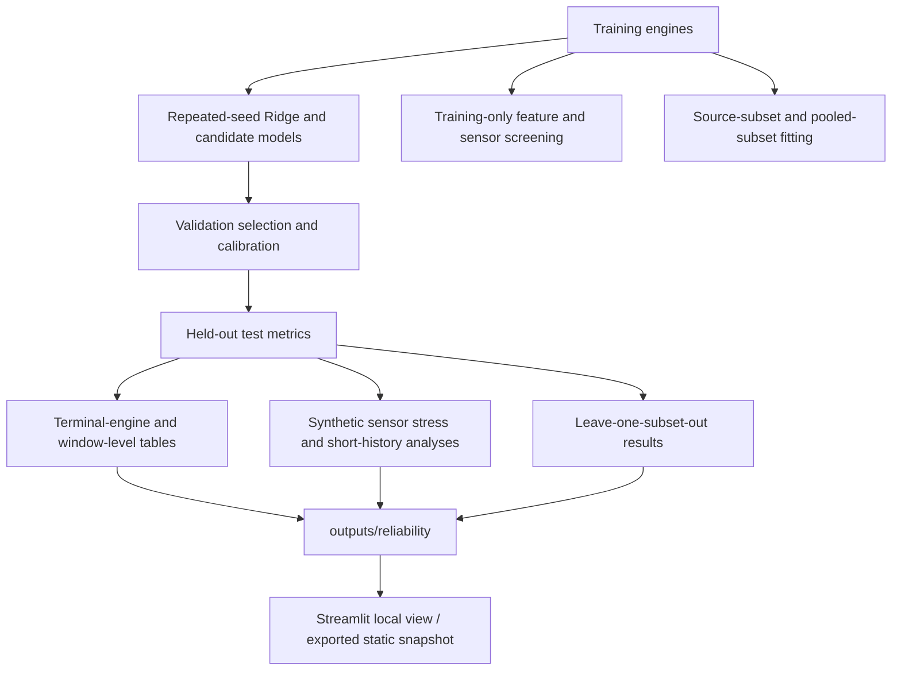
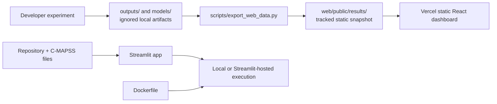

# Current system architecture

**Status:** implemented architecture inspected on 2026-10-29. This document describes the checked-in code and deployment artifacts, not proposed functionality. The older [`SYSTEM_ARCHITECTURE.md`](SYSTEM_ARCHITECTURE.md) retains design notes from earlier stages; this page is the current module and data-flow reference.

## System boundary

The project is a research benchmark and demonstration application for estimating turbofan remaining useful life (RUL) from the simulated NASA C-MAPSS FD001-FD004 trajectories. It is not connected to aircraft sensors, maintenance systems, or a live fleet. The trained model and static result bundle are separate: the Streamlit app can run a local Ridge experiment, while the React dashboard reads the committed JSON and image artifacts exported from prior runs.

## End-to-end experiment

```mermaid
flowchart LR
    A[Bundled C-MAPSS files<br/>or CMAPSS_DATA_DIR] --> B[DataLoader]
    B --> C[Schema and trajectory validation]
    C --> D[Training and test RUL labels]
    D --> E[Engine-level train / validation split]
    E --> F[Training-only sensor filtering and scaling]
    F --> G[Per-engine 30-cycle windows]
    G --> H[Ridge window-summary baseline]
    G --> I[Optional TensorFlow LSTM]
    H --> J[Validation metrics and model selection]
    I --> J
    J --> K[Official test evaluation]
    J --> L[Validation residual calibration]
    K --> M[Metrics, predictions, reports, Matplotlib figures]
    L --> M
    M --> N[Streamlit local results]
    M --> O[Export script]
    O --> P[Committed JSON and figure bundle]
    P --> Q[React / Vite dashboard]
```

### Data and leakage boundary

1. `ProjectConfig` selects a subset and resolves the bundled dataset directory, unless `CMAPSS_DATA_DIR` overrides it.
2. `DataLoader` reads the 26-column C-MAPSS tables; `DataValidator` checks required numeric columns, finite values, unique engine-cycle keys, and sequential cycles.
3. The training RUL is each engine's final training cycle minus the current cycle, optionally capped at 125. Test RUL adds the official final-cycle label to each test engine's observed remaining cycles.
4. Training engines are split into fit and validation groups with the configured seed. Constant-sensor filtering and the scaler are fit on the fit engines; validation and test data are transformed with those fitted objects.
5. Windows are generated independently within each engine. Complete windows use the configured 30-cycle history and are labeled at the last cycle.
6. Ridge and, when requested and available, the stacked LSTM produce validation and test predictions. Validation MAE selects the displayed model. Test labels are used for evaluation after this selection; they do not select the model.
7. Split-conformal absolute-residual intervals use validation predictions for calibration. Their test coverage is a retrospective measurement and is not a guarantee under dependent windows or domain shift.

The primary run reports window-level test metrics. The reliability study also reports terminal-engine metrics and names the aggregation unit explicitly. These scores are not interchangeable.

## Components and interfaces

| Component | Responsibility | Main implementation |
|---|---|---|
| Configuration | Dataset choice, paths, window size, cap, seed, model options | `src/config.py` |
| Data | Read 26-column tables, construct labels, validate trajectories | `src/data_loader.py`, `src/target_construction.py`, `src/data_validator.py` |
| Preprocessing | Engine split, constant-channel filtering, scaling, windows | `src/data_splitter.py`, `src/data_cleaner.py`, `src/normalization.py`, `src/sequence_generator.py` |
| Models | Window-summary Ridge; optional stacked LSTM | `src/baseline_model.py`, `src/lstm_model.py`, `src/trainer.py` |
| Experiment | Orchestrate a subset run and persist artifacts | `src/pipeline.py`, `src/train_all.py` |
| Evaluation and analyses | Error metrics, intervals, sensor screening, life-stage proxy, transfer and reliability protocols | `src/evaluator.py`, `src/uncertainty.py`, `src/research_analysis.py`, `src/segmentation_analysis.py`, `src/transfer_analysis.py`, `src/reliability_analysis.py` |
| Visualization | Matplotlib figures for outputs and dashboards | `src/visualizer.py` |
| Streamlit application | Explore data, run Ridge/LSTM experiments when dependencies permit, inspect artifacts, and forecast uploaded histories with Ridge | `src/streamlit_dashboard.py` |
| Static results export | Convert local outputs to portable dashboard JSON and figures | `scripts/export_web_data.py` |
| Web application | Browse committed benchmark, transfer, reliability, maintenance scenario, and methods views | `web/src/main.jsx`, `web/public/results/` |
| Maintenance scenario engine | Recompute assumed service-allocation scenarios from a fixed input snapshot | `scripts/maintenance_what_if.jl` |
| Optional native diagnostics | C++17/pybind11 PCA and K-Means parity/timing experiment; separate from RUL inference | `cpp_engine/`, `src/cpp_bridge.py`, `src/run_cpp_benchmark.py` |

The two apps do not call a shared prediction API. The web app is a static results viewer. The Streamlit forecast tab currently uses the saved Ridge artifact; it does not call the saved LSTM model for uploaded histories.

## Supporting research workflows

The onset detector uses a capped-RUL-derived proxy label, fractional-life analysis uses retrospective lifetime information, and sensor stress uses synthetic interventions. Those outputs are research diagnostics, not physical fault detection or field reliability measurements. See [`RELIABILITY_AND_ROBUSTNESS.md`](RELIABILITY_AND_ROBUSTNESS.md).

## Deployment and artifact flow

The source includes deployment entry points and public app links, but this repository audit does not inspect Vercel or Streamlit account settings, secrets, or live service health. Generated training weights and `outputs/` are git-ignored. Dashboard snapshots are refreshed explicitly with `python scripts/export_web_data.py` after experiments.

## Repository map

| Path | Contents |
|---|---|
| `src/` | Python data, model, research, reliability, and dashboard modules |
| `tests/` | Unit and application-data tests |
| `Ref/CMAPSSData/` | Included FD001-FD004 train/test trajectories and RUL labels |
| `Ref/*.pdf` | Supplied research papers and dataset reference material |
| `web/` | React/Vite source and committed static dashboard artifacts |
| `docs/` | Methods, protocols, results, diagrams, limitations, and audit records |
| `scripts/` | Data export and Julia scenario analysis |
| `cpp_engine/` | Optional C++17 extension and standalone benchmark |
| `animations/` | ManimGx source for the bundled RUL methods explainer |
| `data/` | Fixed input snapshot for the Julia what-if analysis |
| `outputs/`, `models/` | Generated local artifacts; intentionally ignored by Git |

## Runtime and failure behavior

- Ridge and the static results views do not require TensorFlow.
- LSTM training is only enabled when TensorFlow is installed. The checked-in default environment is Python 3.12; the deployment requirements skip TensorFlow on Python 3.14.
- Missing dataset files, schema errors, test-label count mismatches, and empty window splits raise explicit errors in the pipeline.
- The C++ module and Julia executable are optional for the core RUL workflow. Julia is needed to regenerate the maintenance scenario CSV; the deployed dashboards read the committed CSV.
- ManimGx is needed only to render a replacement animation, not to play the bundled video or run either application.
